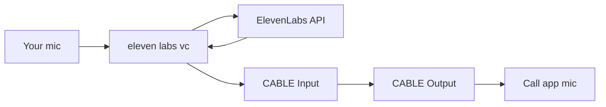

# eleven labs vc 🎙️

**An easier-to-use voice changer for calls, built on ElevenLabs speech-to-speech.**

Talk normally, pause, and the people in your Discord, Zoom, Teams or WhatsApp call hear you in an AI voice.

> This is a fork of **[elevenlabs-live-vc](https://github.com/cavoq/elevenlabs-live-vc) by [cavoq](https://github.com/cavoq)** (David Stromberger), with contributions from [ayeantics](https://github.com/ayeantics).
> All of the core voice-changing code is theirs. This fork adds a one-click Windows setup, hands-free mode as the default, and fixes for common setup errors. See [CREDITS.md](CREDITS.md) and [CHANGES.md](CHANGES.md).

---

## How it works



1. **You speak.** The app starts recording as soon as it hears your voice.
2. **You pause.** After about 0.8 s of silence it sends the clip to ElevenLabs.
3. **The new voice plays into VB-Cable**, a free virtual audio cable. Your call app uses VB-Cable as its microphone.

**This is not a real-time voice changer like MorphVOX.** It converts phrase by phrase, so the other person hears each sentence about 1–3 seconds after you finish it. That's fine for normal conversation, but too slow for fast gaming callouts.

---

## Quick start (Windows)

### 1. Get the things you need

| What | Where | Notes |
|---|---|---|
| ElevenLabs account and API key | [elevenlabs.io/app/settings/api-keys](https://elevenlabs.io/app/settings/api-keys) | The free plan works with the premade voices |
| VB-Cable (free) | [vb-audio.com/Cable](https://vb-audio.com/Cable/) | Unzip, right-click `VBCABLE_Setup_x64.exe` → **Run as administrator** → **Install Driver**, then reboot |
| Python launcher **or** winget | Already on most Windows 10/11 PCs | Setup uses one of them to install everything else |

### 2. Run setup

Double-click **`setup.bat`**. It:

- installs [uv](https://docs.astral.sh/uv/) if you don't have it,
- downloads a private Python 3.13 into this folder (`.python/`) and leaves any Python you already have alone,
- installs the packages into `.venv/`,
- creates `.env` and opens it in Notepad.

### 3. Fill in `.env`

```env
API_KEY=sk_...your key...
VOICE_ID=XrExE9yKIg1WjnnlVkGX   # Matilda, a free premade voice
```

To see every voice your key can use, run `start.bat --voices`.

### 4. Start it

Double-click **`start.bat`**. You'll see something like:

```
Mode:   hands-free (speak, then pause)
Mic:    Microphone (HyperX SoloCast) [#1]
Output: CABLE Input (VB-Audio Virtual Cable) [#7]
[VAD] Listening for voice...
```

### 5. Pick the mic in your call app

In Discord, Zoom, Teams, OBS or WhatsApp Desktop, open **Settings → Voice/Audio → Input device** and choose **CABLE Output (VB-Audio Virtual Cable)**.

**To hear yourself:** open Windows **Sound settings → More sound settings → Recording → CABLE Output → Properties → Listen**, tick **Listen to this device**, and choose your headphones.

---

## Everyday use

| Do this | How |
|---|---|
| Start / stop | `start.bat` / type `quit` or press Ctrl+C |
| Switch to push-to-talk | Type `set_mode 0`, then press SPACE to start and SPACE to stop. To make it permanent, set `MODE=0` in `.env` |
| Back to hands-free | `set_mode 1` |
| Show the current mode | `get_mode` |
| List microphones and outputs | `start.bat --devices` |
| List your voices | `start.bat --voices` |

---

## Settings (`.env`)

All settings are explained in [`.env.example`](.env.example). These are the ones you're most likely to change:

| Setting | Default | What it does |
|---|---|---|
| `API_KEY` | *(required)* | Your ElevenLabs API key |
| `VOICE_ID` | Matilda | The voice you speak with |
| `MODE` | `1` | `1` = hands-free, `0` = push-to-talk (SPACE) |
| `INPUT_DEVICE` / `INPUT_DEVICE_NAME` | Windows default | Which mic to use: a number from `--devices` or part of its name |
| `OUTPUT_DEVICE_NAME` / `OUTPUT_DEVICE` | `CABLE Input` | Where the voice goes. Falls back to your speakers if it isn't found |
| `VAD_THRESHOLD` | `0.01` | How loud you need to be to trigger recording. Raise it (0.02–0.05) if noise sets it off |
| `VAD_SILENCE_DURATION` | `0.8` | Seconds of silence before a phrase is sent |
| `REMOVE_BACKGROUND_NOISE` | `1` | Ask ElevenLabs to clean up the recording |

Advanced: `SAMPLE_RATE`, `CHANNELS`, `SILENCE_THRESHOLD`, `OUTPUT_SAMPLE_RATE`, `API_SAMPLE_RATE`, `VAD_MIN_RECORDING_DURATION`, `VAD_PRE_BUFFER_DURATION`, `MIN_AUDIO_DURATION`.

---

## Troubleshooting

| Message | Fix |
|---|---|
| `ElevenLabs error 402 ... Free users cannot use library voices` | Free accounts can only use **premade** voices. Run `start.bat --voices` and pick one marked `premade`, or upgrade your ElevenLabs plan |
| `ElevenLabs error 401` | Your `API_KEY` is wrong or was revoked |
| `No output matches 'CABLE Input'` | VB-Cable isn't installed yet, or you haven't rebooted since installing it. Until then the voice plays through your speakers |
| `No microphone matches ...` | Run `start.bat --devices` and set `INPUT_DEVICE` to the number |
| It keeps triggering on background noise | Raise `VAD_THRESHOLD`, or use push-to-talk (`MODE=0`) |
| It cuts you off mid-sentence | Raise `VAD_SILENCE_DURATION`, e.g. to 1.2 |
| Call app hears nothing | Make sure its input is **CABLE Output** (not CABLE Input) and that the startup line says `Output: CABLE Input` |
| Credits run out fast | Every phrase is billed by ElevenLabs. Push-to-talk avoids converting noise you didn't mean to send |

---

## Manual install (any OS)

```bash
uv sync                 # or: pip install -r requirements.txt  (Python 3.12 or 3.13)
cp .env.example .env    # then edit it
uv run python live-vc.py
```

Docker (Linux, upstream setup):

```bash
docker build -t el-live-vc .
docker run --env-file .env -it --privileged -v /dev/input:/dev/input el-live-vc
```

---

## Credits

- **Original project:** [cavoq/elevenlabs-live-vc](https://github.com/cavoq/elevenlabs-live-vc) by [cavoq](https://github.com/cavoq) (David Stromberger)
- **Contributors to the original:** [ayeantics](https://github.com/ayeantics)
- **Voice AI:** [ElevenLabs](https://elevenlabs.io)
- **Virtual audio cable:** [VB-Audio](https://vb-audio.com)

Full details are in [CREDITS.md](CREDITS.md).

## License

GNU General Public License v3.0, the same as the original project. See [LICENSE](LICENSE). You can share and modify this project, but copies must keep the license and the credits, and must make their source available under GPL-3.0.
