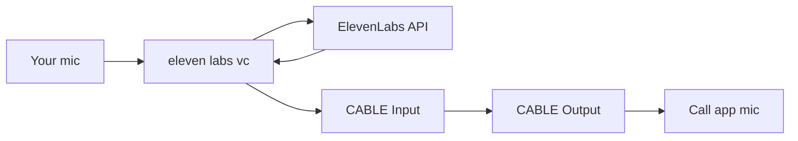

# eleven labs vc 🎙️

**An easier-to-use voice changer for calls, built on ElevenLabs speech-to-speech.**

Talk normally, pause, and the people in your Discord, Zoom, Teams or WhatsApp call hear you in an AI voice.

> This is a fork of **[elevenlabs-live-vc](https://github.com/cavoq/elevenlabs-live-vc) by [cavoq](https://github.com/cavoq)** (David Stromberger), with contributions from [ayeantics](https://github.com/ayeantics).
> All of the core voice-changing code is theirs. This fork adds a simple window, a one-click Windows setup, hands-free mode as the default, and fixes for common setup errors. See [CREDITS.md](CREDITS.md) and [CHANGES.md](CHANGES.md).

## Which file do I double-click?

| File | When |
|---|---|
| **`setup.bat`** | Once, the first time (and again after updating the project) |
| **`start-ui.bat`** | Every time you want to use the voice changer. Opens the window |
| `start.bat` | Optional: the original command-line version, without the window |

---

## How it works



1. **You speak.** The app starts recording as soon as it hears your voice.
2. **You pause.** After about 0.5 s of silence it sends the clip to ElevenLabs.
3. **The new voice plays into VB-Cable**, a free virtual audio cable. Your call app uses VB-Cable as its microphone.


---

## Quick start (Windows)

### 1. Get the things you need

| What | Where | Notes |
|---|---|---|
| ElevenLabs account and API key | [elevenlabs.io/app/settings/api-keys](https://elevenlabs.io/app/settings/api-keys) | The free plan works with the premade voices |
| VB-Cable (free) | [vb-audio.com/Cable](https://vb-audio.com/Cable/) | Unzip, right-click `VBCABLE_Setup_x64.exe` → **Run as administrator** → **Install Driver**. Reboot if "CABLE Input" doesn't show up afterwards |
| Python launcher **or** winget | Already on most Windows 10/11 PCs | Setup uses one of them to install everything else |

### 2. Run setup

Double-click **`setup.bat`**. It:

- installs [uv](https://docs.astral.sh/uv/) if you don't have it,
- downloads a private Python 3.13 into this folder (`.python/`) and leaves any Python you already have alone,
- installs the packages into `.venv/`,
- creates `.env`, your settings file, and opens it in Notepad. You can close Notepad: the window in the next step fills it in for you.

### 3. Open the window

Double-click **`start-ui.bat`**.

1. Paste your **API key** at the bottom and press **↻** next to *Voice* to load your voices.
2. Pick a **Voice**. Free accounts can only use the ones marked *(premade)*, such as Matilda.
3. Check **Microphone** (your real mic) and **Send voice to** (**CABLE Input** for calls).
4. Press **▶ Start** and say something. The dot turns orange while you talk and blue while it converts.
5. Set the **Talk threshold**: stay quiet, look at the grey bar, and drag the slider so the red line sits just above it.

Everything you change is saved to `.env`, so next time just open the window and press Start.

**Closing the window (X) stops everything and exits the app.** Nothing keeps running in the background.

| Control | What it does |
|---|---|
| **Start / Stop** | Starts listening. The dot shows Listening (green), Recording (orange) or Converting (blue) |
| **Mic level + Talk threshold** | The bar is your mic level. Drag the red line just above the bar's level when you're silent: anything louder counts as talking |
| **Pause before sending** | How long you must stay quiet before a phrase is sent. Shorter means faster replies |
| **Output volume** | Volume of the converted voice |
| **Noise suppression** | ElevenLabs cleans up the recording. Slower, so only use it in noisy rooms |
| **Mute** | Stops sending without closing the app |
| **Voice / Microphone / Send voice to / API key** | Your setup. All settings are saved to `.env` |

In the window you can **keep talking while the previous phrase converts**: phrases queue up instead of the mic waiting for each reply. Phrases longer than 12 s are sent in pieces. If you send the voice to your speakers instead of VB-Cable, the mic pauses while the voice plays, so it doesn't convert its own output.

### 4. Pick the mic in your call app

In Discord, Zoom, Teams, OBS or WhatsApp Desktop, open **Settings → Voice/Audio → Input device** and choose **CABLE Output (VB-Audio Virtual Cable)**.

**To hear yourself:** open Windows **Sound settings → More sound settings → Recording → CABLE Output → Properties → Listen**, tick **Listen to this device**, and choose your headphones.

---

## Everyday use

**With the window (`start-ui.bat`)**

| Do this | How |
|---|---|
| Start / stop the voice changer | **▶ Start** / **■ Stop** |
| Pause without closing | Tick **Mute** |
| Faster replies | Move **Pause before sending** left (0.3–0.4 s) |
| It triggers on background noise | Move **Talk threshold** right, or tick **Noise suppression** |
| Change the voice | Pick another **Voice**. It applies to the next phrase |
| Quit | Close the window (X). The app exits completely |

**With the command line (`start.bat`)**

At startup it shows the mode and devices in use:

```
Mode:   hands-free (speak, then pause)
Mic:    Microphone (HyperX SoloCast) [#2]
Output: CABLE Input (VB-Audio Virtual Cable) [#6]
[VAD] Listening for voice...
```

| Do this | How |
|---|---|
| Start / stop | `start.bat` / type `quit` or press Ctrl+C |
| Switch to push-to-talk | Type `set_mode 0`, then press SPACE to start and SPACE to stop. To make it permanent, set `MODE=0` in `.env` |
| Back to hands-free | `set_mode 1` |
| Show the current mode | `get_mode` |
| List microphones and outputs | `start.bat --devices` |
| List your voices | `start.bat --voices` |

---

## Settings (`.env`)

The window saves most of these for you. You only need to edit `.env` by hand for the command-line version or the advanced options. All settings are explained in [`.env.example`](.env.example). These are the ones you're most likely to change:

| Setting | Default | What it does |
|---|---|---|
| `API_KEY` | *(required)* | Your ElevenLabs API key |
| `VOICE_ID` | Matilda | The voice you speak with |
| `MODE` | `1` | `1` = hands-free, `0` = push-to-talk (SPACE) |
| `INPUT_DEVICE` / `INPUT_DEVICE_NAME` | Windows default | Which mic to use: a number from `--devices` or part of its name |
| `OUTPUT_DEVICE_NAME` / `OUTPUT_DEVICE` | `CABLE Input` | Where the voice goes. Falls back to your speakers if it isn't found |
| `VAD_THRESHOLD` | `0.01` | How loud you need to be to trigger recording. Raise it (0.02–0.05) if noise sets it off |
| `VAD_SILENCE_DURATION` | `0.5` | Seconds of silence before a phrase is sent. Lower = faster, but it may cut you off |
| `OUTPUT_GAIN` | `1.5` | Volume of the converted voice (1.0 = unchanged) |
| `NORMALIZE_INPUT` | `1` | Boost quiet recordings before sending them |
| `REMOVE_BACKGROUND_NOISE` | `0` | Ask ElevenLabs to clean up the recording. Slower, so only turn it on in noisy rooms |
| `UPLOAD_SAMPLE_RATE` | `16000` | The clip is downsampled to this before upload, so it uploads faster |
| `OPTIMIZE_STREAMING_LATENCY` | `3` | 0–4: ask ElevenLabs to start streaming sooner |

Advanced: `SAMPLE_RATE`, `CHANNELS`, `SILENCE_THRESHOLD`, `OUTPUT_SAMPLE_RATE`, `API_SAMPLE_RATE`, `VAD_MIN_RECORDING_DURATION`, `VAD_PRE_BUFFER_DURATION`, `MIN_AUDIO_DURATION`.

---

## Troubleshooting

| Message | Fix |
|---|---|
| `ElevenLabs error 402 ... Free users cannot use library voices` | Free accounts can only use **premade** voices. Run `start.bat --voices` and pick one marked `premade`, or upgrade your ElevenLabs plan |
| `ElevenLabs error 401` | Your `API_KEY` is wrong or was revoked |
| `No output matches 'CABLE Input'` | VB-Cable isn't installed yet, or you haven't rebooted since installing it. Until then the voice plays through your speakers |
| `No microphone matches ...` | Run `start.bat --devices` and set `INPUT_DEVICE` to the number |
| It keeps triggering on background noise | Raise `VAD_THRESHOLD`, or use push-to-talk (`MODE=0`) |
| It cuts you off mid-sentence | Raise `VAD_SILENCE_DURATION`, e.g. to 0.8–1.2 |
| Voice too quiet or too loud | Change `OUTPUT_GAIN` (e.g. 2.0 louder, 1.0 original). Above ~2.5 it can distort |
| Still feels slow | Speak in shorter phrases: the wait is mostly the pause plus ElevenLabs processing. A wired connection helps too |
| Call app hears nothing | Make sure its input is **CABLE Output** (not CABLE Input) and that the startup line says `Output: CABLE Input` |
| Credits run out fast | Every phrase is billed by ElevenLabs. Push-to-talk avoids converting noise you didn't mean to send |

---

## Manual install (any OS)

```bash
uv sync                 # or: pip install -r requirements.txt  (Python 3.12 or 3.13)
cp .env.example .env    # then edit it
uv run python live-vc.py
```

Docker (Linux, upstream setup):

```bash
docker build -t el-live-vc .
docker run --env-file .env -it --privileged -v /dev/input:/dev/input el-live-vc
```

---

## Credits

- **Original project:** [cavoq/elevenlabs-live-vc](https://github.com/cavoq/elevenlabs-live-vc) by [cavoq](https://github.com/cavoq) (David Stromberger)
- **Contributors to the original:** [ayeantics](https://github.com/ayeantics)
- **Voice AI:** [ElevenLabs](https://elevenlabs.io)
- **Virtual audio cable:** [VB-Audio](https://vb-audio.com)

Full details are in [CREDITS.md](CREDITS.md).

## License

GNU General Public License v3.0, the same as the original project. See [LICENSE](LICENSE). You can share and modify this project, but copies must keep the license and the credits, and must make their source available under GPL-3.0.
